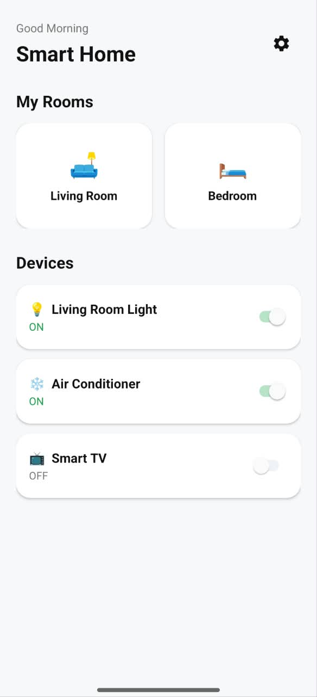
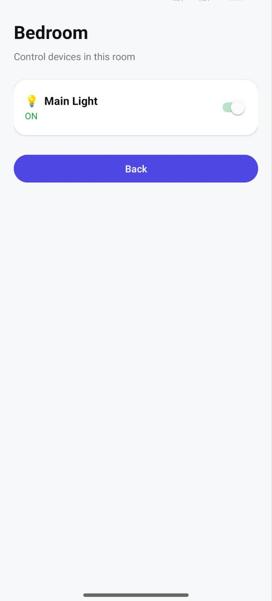
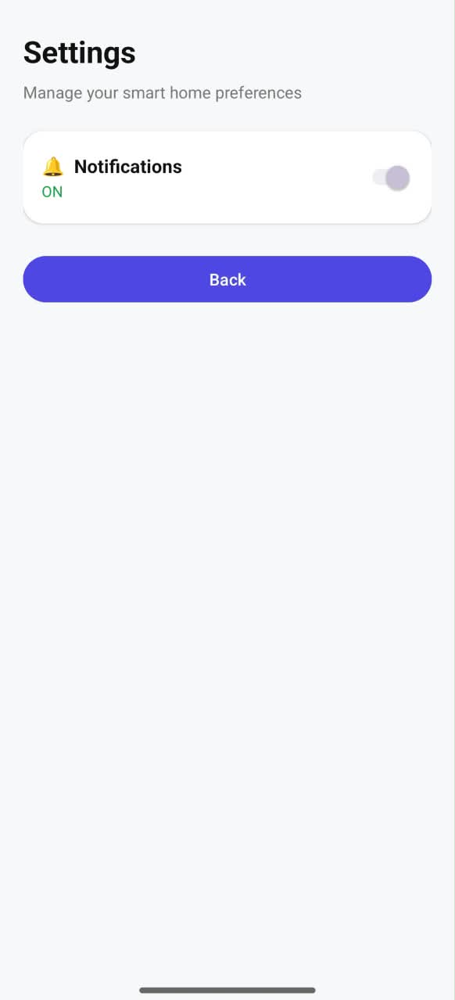

# 🏠 Smart Home App

A clean and simple Android app for controlling home devices, built with **Java** and **Android Studio**.

## ✨ Features

- Modern home screen with rooms and devices
- ON/OFF switches with live status (green when ON)
- Clickable room cards that open a Room Details screen
- Room name passed between screens using Intents
- Settings screen with a notifications toggle
- Clean card-based UI with ScrollView
- Custom app icon and name

## 🛠 Tech Stack

- Java
- Android Studio
- XML layouts (ConstraintLayout, LinearLayout, CardView, ScrollView)
- Activities and Intents

## 📱 Screens

  
  
  

## 🚀 How to Run

1. Clone the repository
2. Open it in Android Studio
3. Let Gradle sync finish
4. Run on an emulator or a real Android device

## 👤 Author

**Waleed Arshad**

Android Developer
LinkedIn: [Waleed Arshad](https://www.linkedin.com/in/waleed-arshad-1b0882288/)
